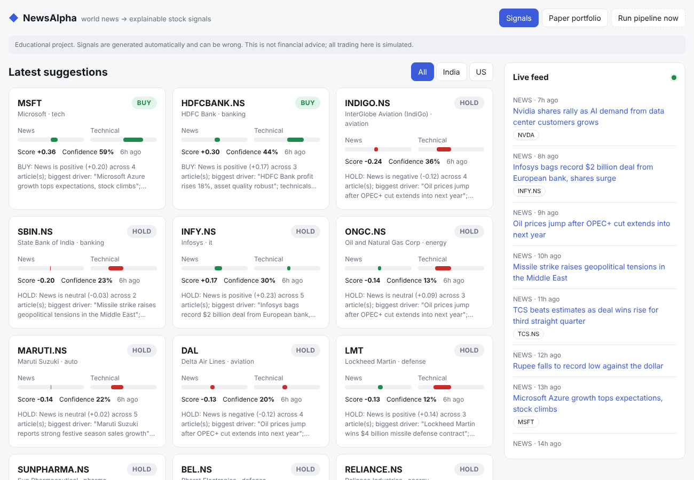
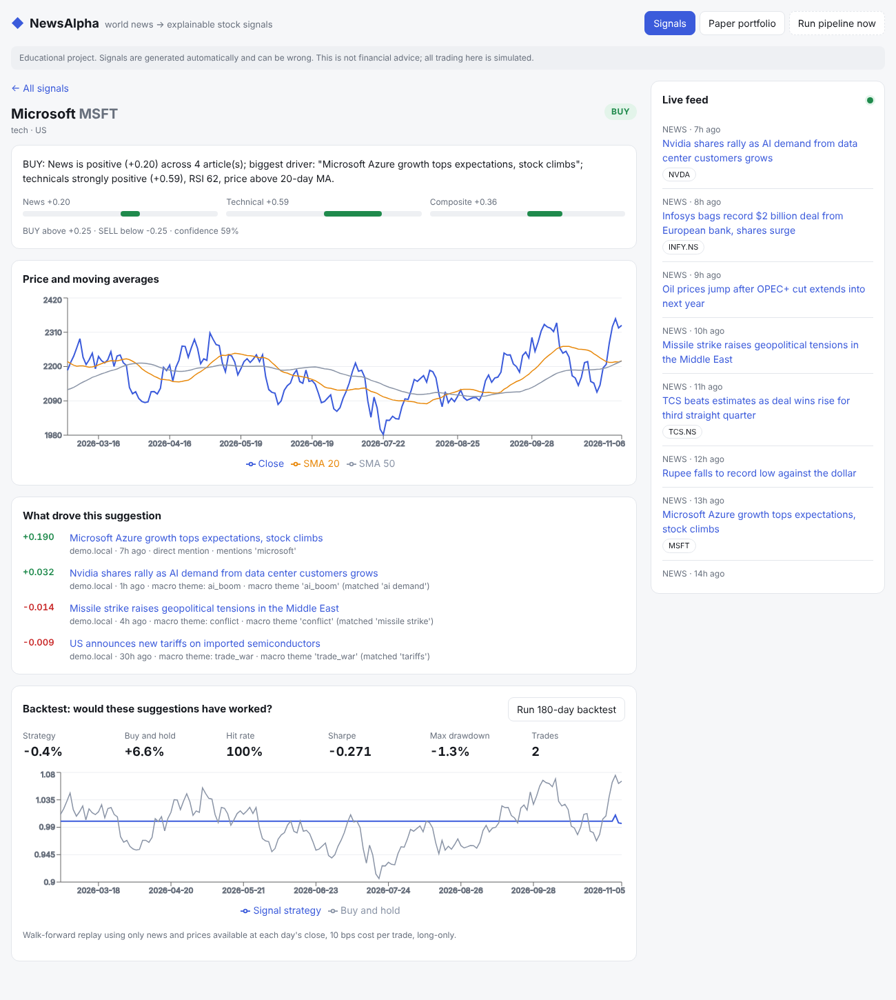
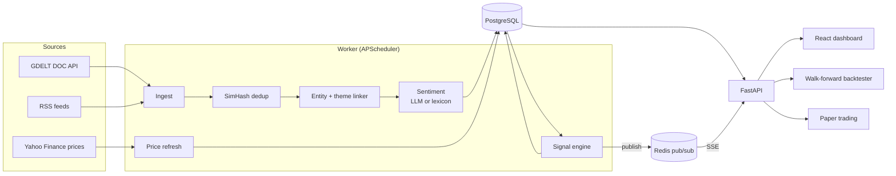

# NewsAlpha

**Reads world news in real time and turns it into explainable BUY / SELL / HOLD suggestions for Indian (NSE) and US stocks. It also backtests whether those suggestions would have worked.**




> ⚠️ Educational project. Signals are generated automatically, can be wrong, and are **not financial advice**. All trading is simulated.

## What it does

1. **Ingests global news every 10 minutes** from the [GDELT 2.0](https://www.gdeltproject.org/) global news firehose plus business RSS feeds (BBC, CNBC, Economic Times, Mint).
2. **Removes syndicated duplicates** with 64-bit SimHash, so one Reuters story copied by 40 sites counts once.
3. **Links each article to stocks** in two ways:
   - *Direct*: "Infosys bags $2bn deal" → `INFY.NS`
   - *Macro theme*: "Brent surges after OPEC+ cut" → energy ↑, airlines ↓, autos ↓ (12 themes: oil, rates, tariffs, conflict, rupee, FDA, AI demand…)
4. **Scores sentiment per stock**, using either an LLM (any OpenAI-compatible API, including the free tiers of Groq and Gemini, or local Ollama) that reasons about second-order effects, or an offline finance lexicon with negation handling.
5. **Fuses news with technicals** (RSI, 20/50-day moving averages, volatility-normalised momentum), using time decay and Bayesian-style shrinkage, into a composite score → **BUY / SELL / HOLD + confidence + the exact headlines that drove it**.
6. **Walk-forward backtests** the strategy with strict no-look-ahead: hit rate, Sharpe, max drawdown, vs. buy-and-hold.
7. **Paper trades** manually or automatically on signals, and **streams everything live** to a React dashboard over Server-Sent Events.


<sub>Screenshots use the synthetic demo dataset (`make demo`).</sub>

## Architecture



| Layer | Tech |
|---|---|
| API | FastAPI, Pydantic v2, Server-Sent Events |
| Worker | APScheduler, Redis distributed locks (safe to run multiple replicas) |
| Data | PostgreSQL (SQLite for local dev), SQLAlchemy 2.0 |
| NLP | Regex entity linker, SimHash, OpenAI-compatible LLM client with fallback and caching |
| Quant | pandas/numpy indicators, walk-forward backtester |
| Frontend | React 18, TypeScript, Vite, Recharts |
| Infra | Docker Compose (Postgres, Redis, API, worker, nginx), GitHub Actions CI |

## Quick start

### Option A: Docker (full stack)

```bash
cp .env.example .env          # optional: add a free Groq/Gemini key for LLM sentiment
docker compose up --build
```
Open the dashboard at http://localhost:5173 and the API docs at http://localhost:8000/docs.

### Option B: Local, no Docker

```bash
cp .env.example .env
make install
make demo     # optional: synthetic data so the UI isn't empty while real news arrives
make api      # terminal 1: API + embedded scheduler on :8000
make web      # terminal 2: dashboard on :5173
```

### Backfill history for backtesting
```bash
make backfill   # ~30 days of real GDELT news + 1y of prices (slow by design: GDELT rate limit)
```

## API

| Method | Path | Description |
|---|---|---|
| GET | `/api/signals/latest` | Latest suggestion per stock, strongest first |
| GET | `/api/signals/{ticker}` | Signal history |
| GET | `/api/tickers/{ticker}` | Prices + SMA/RSI + latest signal |
| GET | `/api/news?ticker=` | Linked articles with per-stock impact |
| POST | `/api/backtest` | `{ticker, days, horizon, allow_short}` |
| GET/POST | `/api/portfolio`, `/api/portfolio/trade` | Paper trading |
| GET | `/api/stream` | SSE stream of `article`, `signal`, `trade` events |
| POST | `/api/admin/run?job=all` | Trigger the pipeline manually |

## Configuration

Everything is an environment variable; see [`.env.example`](.env.example) and [`backend/app/config.py`](backend/app/config.py).
Add stocks or macro themes by editing [`backend/app/data/universe.yaml`](backend/app/data/universe.yaml). No code changes are needed.

## Tests

```bash
make test   # 29 tests: dedup, linking, sentiment (+LLM mock), signal math, no-look-ahead backtest, API end-to-end
```

## How it works

The maths, the design decisions, and the known limitations are in **[docs/HOW_IT_WORKS.md](docs/HOW_IT_WORKS.md)**.

## Roadmap
- [ ] FinBERT sentiment model as a third provider
- [ ] Alembic migrations
- [ ] Intraday prices and event studies (abnormal returns around news)
- [ ] Learn the news and technical weights from backtest results instead of hand-tuning
- [ ] Multi-currency paper portfolio (INR + USD)

## License
MIT
